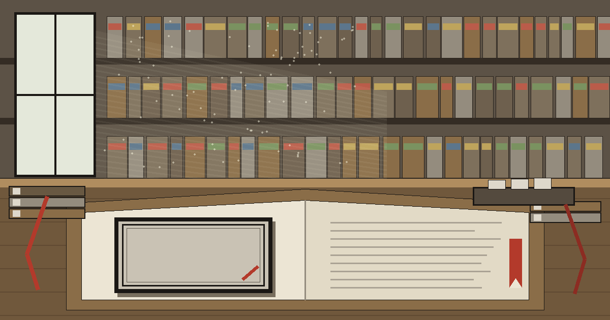
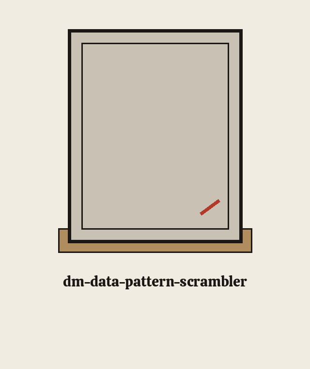
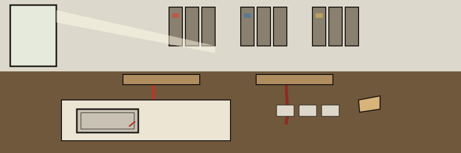

# dm-data-pattern-scrambler

Catalogue entry: the name above is set in Calistoga in ink black, as a catalogue entry for a dispersed library. The plate itself stays blank. No collector name is invented for it.

# dm-data-pattern-scrambler
Replaces identifiable patterns (e.g., phone number formats, credit card patterns) with random but valid patterns of the same type.  Useful for masking data that adheres to known formats, ensuring compliance while rendering the data unusable. - Focused on Tools designed to generate or mask sensitive data with realistic-looking but meaningless values

> Pasted slip: a plate asserts ownership over a volume whose text it leaves alone. This program asserts itself over a pattern shape, swapping the content inside that shape for a valid replacement of the same type. Format survives. Identity does not.

## Install
`git clone https://github.com/ShadowGuardAI/dm-data-pattern-scrambler`

> Pasted slip: the clone line above keeps its published spelling, with the hyphen missing from the organisation name. It is preserved verbatim here. The corrected spelling appears only on the website, labelled as a correction there.

## Usage
`./dm-data-pattern-scrambler [params]`

## Parameters
- `-h`: Show help message and exit
- `-p`: No description provided
- `-l`: No description provided
- `-f`: Path to a file to scramble. Overrides input_text argument if present.
- `-o`: Path to the output file. If not provided, prints to stdout.

> Pasted slip: two documented controls, p and l, carry no description in the source. No description is invented for them here.

## Credit card patterns and output path

Credit card numbers are scrambled in these forms: contiguous runs of 13 to 19 digits, dashed groups of four, and spaced groups of four. Digit boundary guards keep a run longer than 19 digits from being partly scrambled: such a run is left unmatched as a whole rather than masking a prefix and leaving the rest in the output.

The output file must not be the input file. If the resolved output path equals the resolved input path, the run refuses at exit 1 before any write, including when the same file is named through a ./ alias or a symlink.

> Pasted slip: a long digit run is left whole. Card runs longer than 19 digits are left whole and unmatched, by the boundary guard.

> Pasted slip: output must never resolve to the input, with refusal at exit 1 before any write.

## License
Copyright (c) ShadowGuardAI

## Filed in the catalogue

The main button of this re-skin reads Scramble the Patterns. Its file field label reads File to Scramble. Its output field label reads Output File, Blank Means Stdout. Its guard heading reads A Long Digit Run Is Left Whole. It ends with the book closed over its plate, the catalogue entry filed, and the press at rest.
